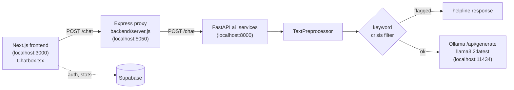

# Panah

Panah is a student mental-health support platform prototype: a Next.js student and admin dashboard with a chat assistant backed by a locally hosted LLM (Llama 3.2 via Ollama). The chat service screens messages for crisis language before they reach the model and steers the conversation using standard screening questionnaires (PHQ-9, GAD-7, PSS-10 and others) written into the system prompt.

> **Team project.** Built with [Ankushsv](https://github.com/Ankushsv), who owns the original repo and wrote the Next.js frontend and Supabase integration. This repo is my fork. My part was the AI chat service and the Express bridge to it; see [My contributions](#my-contributions).

## Architecture



### Request path in `ai_services`

1. `POST /chat` (`chatbot/routes.py`) first checks that Ollama is reachable (`GET /api/tags`). If not, it returns a fixed "service unavailable" message instead of an error.
2. `processor.process_user_message` runs the text through `TextPreprocessor` (`utils/text_processor.py`): HTML/URL/emoji removal, slang expansion, punctuation and stopword removal, lemmatization. NLTK, spaCy, TextBlob and `emoji` are optional imports, so the pipeline degrades instead of crashing when one is missing.
3. `chatbot/safety.py` matches the cleaned text against a short list of self-harm phrases. A hit short-circuits the LLM and returns a message with an Indian helpline number.
4. Otherwise `ai_client.get_llm_response` builds a prompt from a long system prompt, the last 10 messages of conversation memory, and the new message, and calls Ollama's `/api/generate` (temperature 0.7, `num_predict` 400, `top_p` 0.9, 60 s timeout).
5. The route retries up to 3 times with 1.5x backoff, then returns `bot_response`, `clean_text`, and four quick-reply `suggestions` (one is chosen by keywords in the reply: anxiety, sleep, or low mood).

The system prompt asks the model to gather context one question at a time, adapt follow-ups using PHQ-9, GAD-7, PSS-10, a short PSQI, AUDIT-C and the Brief Resilience Scale, stop once it has enough to offer coping strategies, and point to crisis support if self-harm comes up.

### Endpoints (`ai_services`, port 8000)

| Method | Path | Description |
|---|---|---|
| `POST` | `/chat` | `{"message": "..."}` → `{"bot_response", "clean_text", "suggestions"}` |
| `GET` | `/health` | Ollama reachability and installed models |
| `GET` | `/models` | Models installed in Ollama |
| `GET` | `/status` | Service status JSON |
| `GET` | `/` | HTML status page with setup hints |

## Repository layout

```
ai_services/        FastAPI chat service (Python)
  app.py            app, CORS for localhost:3000, status pages
  chatbot/          routes.py, processor.py, ai_client.py, safety.py
  utils/            text_processor.py, config.py, logger.py
  cli_chat.py       terminal client
backend/
  server.js         Express proxy on :5050 -> FastAPI :8000
  src/models/       Mongoose schemas (not yet connected)
  src/routes/       empty placeholders
frontend/           Next.js 15 + Tailwind + Radix UI dashboard (student and admin views)
requirement.txt     `pip list` dump of the dev environment
```

## Running locally

Requires Python 3, Node.js, and [Ollama](https://ollama.com).

```bash
# 1. Local model
ollama serve
ollama pull llama3.2

# 2. AI service (run from the repo root; imports use the ai_services package path)
pip install fastapi uvicorn aiohttp requests python-dotenv googletrans nltk
uvicorn ai_services.app:app --reload --port 8000

# 3. Express proxy
npm install
node backend/server.js          # http://localhost:5050

# 4. Frontend
cd frontend
npm install
npm run dev                     # http://localhost:3000
```

Quick test of the chat service:

```bash
curl -X POST http://localhost:8000/chat \
  -H "Content-Type: application/json" \
  -d '{"message": "I feel anxious"}'
```

`requirement.txt` is the output of `pip list`, not a requirements file, so `pip install -r` won't work on it. `ai_services/requirements.txt` and `ai_services/Dockerfile` are empty. The list above is what the chat path imports.

## My contributions

From `git log --author=aadvikchaturvedi` (14 commits, Sep 2025):

- **AI chat service (`ai_services/`)**: the FastAPI app, chat route with health-gated retries and quick-reply suggestions, the Ollama client and screening system prompt, the keyword crisis filter, the text preprocessing pipeline, `/health`, `/models` and `/status` endpoints, and the CLI client.
- **Express bridge (`backend/server.js`)**: CORS-enabled proxy on port 5050 forwarding `/chat` to FastAPI, and the change in `Chatbox.tsx` to call it.
- **Data models (`backend/src/models/model.js`)**: Mongoose schemas for students, forums, buddy check-ins, questionnaires, mood journals and admin analytics, with bcrypt password hashing and AES-256-CBC field encryption (via Mongoose getters/setters) on journal entries, check-in messages and questionnaire responses.

The Next.js frontend (dashboards, chatbox UI and its client-side crisis check, booking, forum, journal, admin analytics), Supabase auth, and API utilities are Ankushsv's work.

## Limitations / next steps

- **Conversation memory is a module-level list** in `ai_client.py`, so every user shares the same 10-message history. It needs to be keyed by session.
- **The crisis filter is four keyword patterns**, matched after preprocessing (which lemmatizes and drops stopwords, so multi-word phrases can be altered before matching). A classifier is the obvious replacement, as the code comment says.
- **Crisis numbers disagree**: the backend replies with an Indian helpline, the frontend's own client-side check shows US numbers (988, 911).
- **Translation isn't on the live path.** `ai_client.py` has a variant of `process_user_message` that translates input to English with `googletrans`, but `/chat` uses `processor.process_user_message`, which doesn't translate.
- `check_llm_health_async` calls the blocking `requests` library inside an async handler, and every `/chat` call does two health checks.
- The status page and startup log tell users to pull `llama3.1:8b`, but the client is configured for `llama3.2:latest`.
- `cli_chat.py` reads a `response` key; the API returns `bot_response`.
- The Mongoose models aren't connected (no `mongoose.connect`), and the Express route files are empty.
- `model.js` falls back to a hard-coded placeholder `ENCRYPTION_KEY` when the env var is missing; it should fail instead.
- Not a medical tool: there is no clinical validation of the screening flow.
